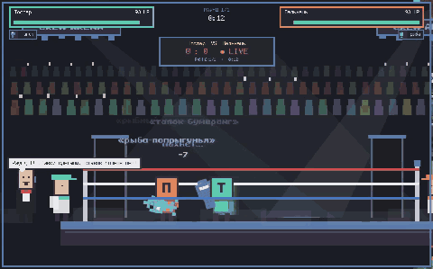
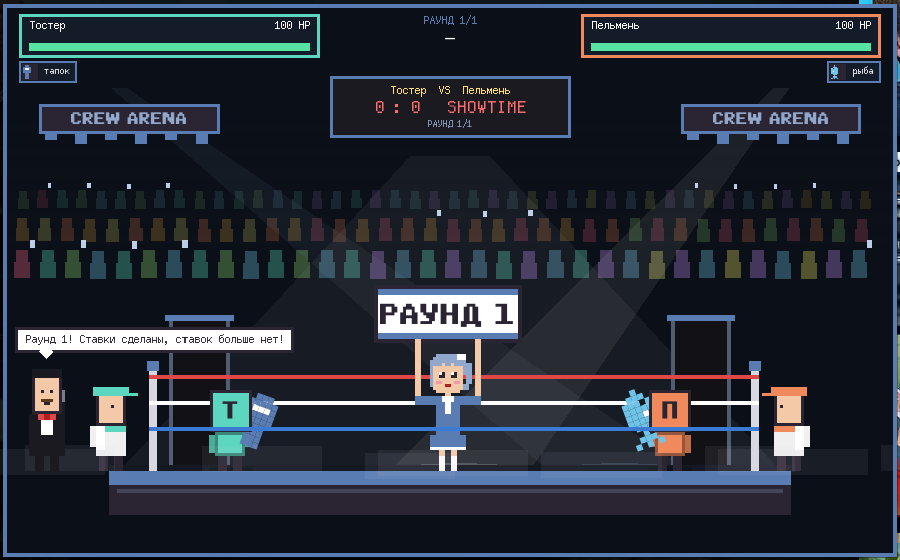
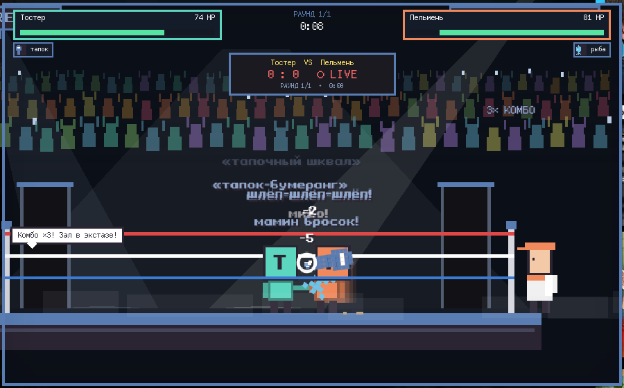
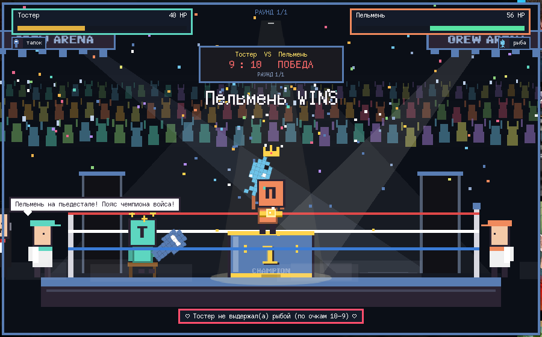
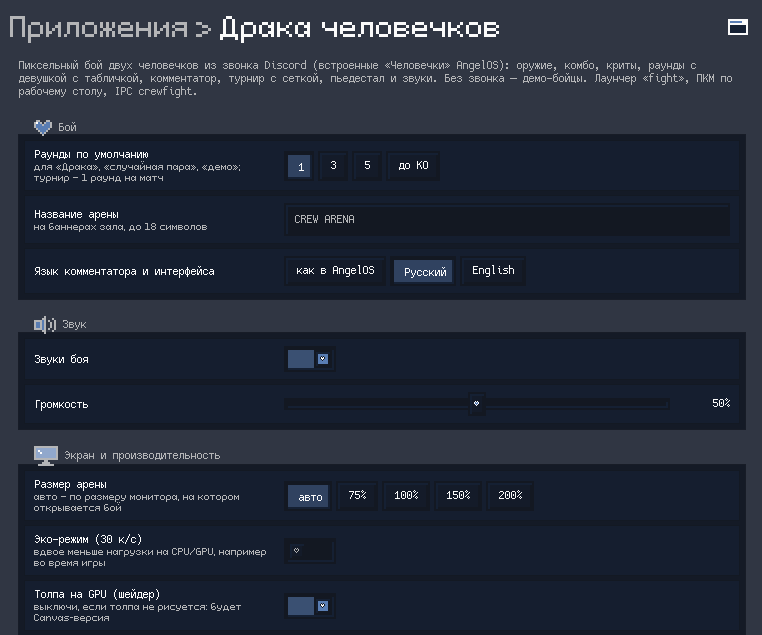

<div align="center">



# 🥊 Crew Fight

**A pixel boxing match between the people in your Discord call — right on your AngelOS desktop.**

[](https://github.com/futureUnd1ground/angelos-community-registry)
[](https://github.com/AbobaAI/angelos-crew-fight/releases/tag/v2.0.0)
[](LICENSE)
[](sounds/LICENSES.txt)
[](#%EF%B8%8F-settings)

**English** | [Русский](README.ru.md)

</div>

---

## ✨ Features

- 👥 **Real fighters** — the "Little People from the Discord Call" AngelOS already draws over the bar; no call → demo fighters.
- ⚔️ **8 weapons**, 3 moves + a finisher each, combos, crits, knockback, stuns.
- 🔔 **Rounds** (1 / 3 / 5 / to KO) with a ring card girl, judges' scores, corner trainers with water, towel & fan.
- 🎙️ **Announcer** and corner advice, fully localized (English / Russian).
- 🏆 **Tournaments** — single elimination for up to 16 fighters, animated bracket, podium & confetti.
- 🔊 **Sound** — per-weapon hits, whooshes, crits, KO, bell/gong, crowd ambience & cheers, fanfare.
- 🖥️ **GPU crowd shader** with a Canvas fallback, auto-fit to your monitor, 🍃 eco mode while gaming.
- 🎨 Works in both AngelOS looks (Pixel and macOS / Golden Gate).

### 🗡️ Weapons

| | Weapon | Moves | Finisher |
|:-:|---|---|---|
| 👊 | Fists | jab · uppercut · flurry | HOOK KNOCKOUT |
| 🩴 | Slipper | slap · slipper storm · slipper boomerang | SLIPPER VERDICT |
| 🏏 | Bat | swing · overhead smash · home run | HOME RUN! GONE! |
| 🐟 | Fish | fish slap · flopping fish · fish overhead | FISH DAY |
| 🎤 | Microphone *(ranged)* | sound wave · feedback · mic to the forehead | MIC DROP |
| ⌨️ | Keyboard | keyboard to the head · key rain · spacebar smash | ALT+F4 |
| 🥖 | Baguette *(heals)* | baguette whack · snack · baguette boomerang | TOASTED |
| 🔴 | Laser pointer *(rare, ranged)* | charged beam · laser eyes · handle jab | LASER MAX |

## 📸 Screenshots

<table>
<tr>
<td></td>
<td></td>
</tr>
<tr>
<td></td>
<td></td>
</tr>
</table>

## 📦 Install

**AngelOS Store:** Settings → Plugins → Community → *Crew Fight* (once the listing is approved).

**One-liner:**

```bash
mkdir -p ~/.config/angelos/plugins && curl -fsSL https://github.com/AbobaAI/angelos-crew-fight/releases/download/v2.0.0/crew-fight-v2.0.0.zip -o /tmp/crew-fight.zip && unzip -oq /tmp/crew-fight.zip -d ~/.config/angelos/plugins/crew-fight && ~/.config/quickshell/angelos/bin/angelos restart
```

**Manual:**

```bash
git clone https://github.com/AbobaAI/angelos-crew-fight
cp -a angelos-crew-fight ~/.config/angelos/plugins/crew-fight
~/.config/quickshell/angelos/bin/angelos restart     # or enable it in Settings → Plugins
```

Requires **AngelOS release 6 ("2004")** or newer. QtMultimedia (sound) ships with AngelOS's Qt.

## 🎧 Discord setup

The plugin has **no Discord connection of its own** — it reads the call AngelOS already reads
(`services/DiscordVoice`). Turn on **Little People from the Discord Call** first (desktop right-click
→ widgets, or `qs -c angelos ipc call angelos discordCrew` to toggle).

| Client | How AngelOS sees the call | You need to |
|---|---|---|
| **Discord** (official app) | local RPC `ws://127.0.0.1:6463–6472` | approve the one-time prompt in Discord |
| **Vesktop / Equibop / Legcord** | arRPC has no voice RPC → AngelOS's opt-in DevTools bridge | start the client with a loopback DevTools port and put `{"port": N}` in `~/.config/angelos/discord-voice.json` (or `$XDG_RUNTIME_DIR/angelos-discord-voice.json`, or `ANGELOS_DISCORD_CDP_PORT`) |

If the crew is off, Discord isn't running, you're not in a voice channel, or only arRPC answers,
the picker tells you why and offers demo fighters.

> [!WARNING]
> A DevTools (remote debugging) port gives full control over that Discord client to anything that
> can reach it. Bind it to **127.0.0.1 only**, never expose it to the network, and don't run untrusted
> local software while it's open. AngelOS's bridge only connects to loopback endpoints on the
> configured port. The official Discord app needs none of this.

## 🎮 Usage

- 🔎 **Launcher** (Mod+Space / Spotlight): `fight`, `crew fight`, `tournament`
- 🖱️ **Desktop right-click:** *Crew Fight* / *Crew Tournament*
- ⌨️ **Keybind** (optional) — add to `~/.config/niri/cfg/user.kdl`:

```kdl
binds {
    Mod+Ctrl+K hotkey-overlay-title="Crew Fight" { spawn "qs" "-c" "angelos" "ipc" "call" "crewfight" "pick"; }
}
```

- 🔌 **IPC:** `qs -c angelos ipc call crewfight <function> [args…]`

| Function | Does |
|---|---|
| `pick` | picker: click two people, choose weapons & rounds |
| `random` · `demo` | random pair from the call · demo pair |
| `brawl A B` | two fighters by name/id, random weapons |
| `fight A B wA wB` · `match A B wA wB rounds` | with weapons (`random` or an id from `weapons`) and rounds |
| `demoMatch rounds` | demo fighters, rounds `1` `3` `5` `ko` |
| `tour` · `tournament rounds` | tournament of everyone in the call |
| `demoTournament` · `demoTournamentN n rounds` | demo tournament (n = 2–16) |
| `weapons` · `status` · `stop` | weapon list · JSON state · stop |

## ⚙️ Settings

Settings → Plugins → Crew Fight, or IPC (persisted the same way):

| Setting | IPC | Default |
|---|---|---|
| Default rounds | `rounds 1\|3\|5\|ko` | `1` |
| Arena name (hall banners) | `arenaName NAME` | `CREW ARENA` |
| Announcer & UI language | `language auto\|ru\|en` | `auto` (as AngelOS) |
| Sound on/off · volume | `sound on\|off\|toggle` · `volume 0-100` | on · `50` |
| Arena size | `scale auto\|50-300` | `auto` (fits the monitor) |
| Eco mode (~25–30 fps) | `eco on\|off\|toggle` | off |
| GPU crowd shader | `shader on\|off` | on (Canvas fallback if it fails) |

## 🏆 Tournament mode

Everyone in the call (or 2–16 demo fighters) is seeded randomly into a single-elimination
bracket; odd counts get byes. Between matches the bracket animates the winner's line into the next
slot; the champion gets the podium and confetti. Rounds: `tournament 1` (default, every match incl.
the final), `tournament 3`, `tournament 1/3` (matches / final), `tournament ko`.

While a fight is on, the fighters' walking copies are hidden (`crewHidden`) and restored afterwards —
also after a crash or shell reload.

## 🔊 Sounds

All 22 sounds were synthesised from scratch with ffmpeg by [`sounds/gen.sh`](sounds/gen.sh) — no
samples, no sound packs — and are released under **CC0 1.0** ([`sounds/LICENSES.txt`](sounds/LICENSES.txt)).
Default volume is a moderate 50% (perceptual curve).

## 📜 Credits & License

Made by **aboba** for [AngelOS](https://github.com/futureUnd1ground/angelos-community-registry).
Code: [MIT](LICENSE) · Sounds: CC0 1.0 · Crowd shader source: [`shaders/crowd.frag`](shaders/crowd.frag)
(rebuild: `qsb --glsl "330,300es,150,120,100es" --hlsl 50 --msl 12 -o crowd.frag.qsb crowd.frag`).
