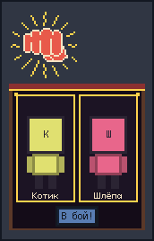
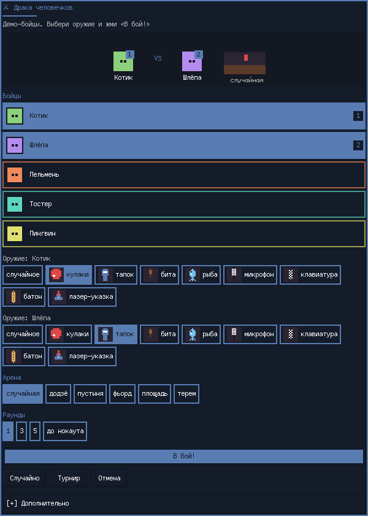
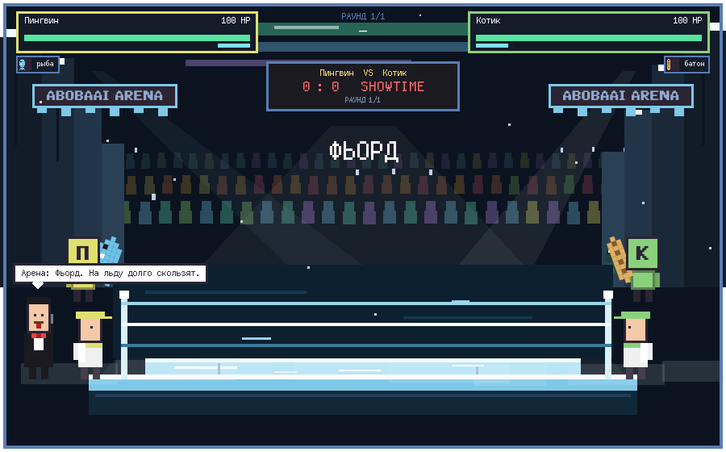

<div align="center">


# 🥊 Драка человечков

**Пиксельный бой людей из твоего звонка Discord — прямо на рабочем столе AngelOS.**

[](https://github.com/futureUnd1ground/angelos-community-registry)
[](https://github.com/AbobaAI/angelos-crew-fight/releases/tag/v2.1.0)
[](LICENSE)
[](sounds/LICENSES.txt)
[](README.md)

[English](README.md) | **Русский**

</div>

---

## ✨ Возможности

- 👥 **Настоящие бойцы** — «Человечки из звонка Discord», которых AngelOS уже рисует над панелью; нет звонка → демо-бойцы.
- ⚔️ **8 видов оружия**, по 3 приёма и добивание, комбо, криты, отбрасывание, оглушение.
- 🛡️ **Щит** — бойцы сами закрываются (урон ×0.2). Идеальный блок оглушает атакующего. Шкалу блока можно проломить.
- 💥 **Суперудар** — шкала под здоровьем. У каждого оружия свой суперудар.
- 💊 **Бонусы** — аптечка, ускорение и бомба. Искусственный интеллект бежит к бонусу или от бомбы. Частоту выпадения можно настроить.
- 🏯 **Пять арен**, у каждой свой зал и одна механика. Можно выбрать зал или **случайную** арену (так по умолчанию). Механики выключаются отдельно, картинка зала остаётся.
- 🔔 **Раунды** (1 / 3 / 5 / до нокаута) с девушкой с табличкой, очки судей, тренеры в углах с водой, полотенцем и веером.
- 🎙️ **Комментатор** и советы из углов — на русском и английском. Название арены коротко показывается в начале боя.
- 🏆 **Турнир** на выбывание до 16 бойцов, анимированная сетка, пьедестал и конфетти.
- 🖼️ **Окно настроек матча** — пиксельная карточка, группы, блок «Дополнительно», короткие анимации и подсказки (пауза ~0,7 с, гаснут, если курсор ушёл). Само по таймеру окно не закрывается.
- 👊 **Виджет рабочего стола `crew`** — кнопка с кулаком. Плавно раскрывается в две ячейки: перетащи человечка из звонка (в ячейке он стоит целиком и не шагает). **Добавить бота** ставит демо-бойца в свободную ячейку. Когда обе заняты, **В бой!** открывает окно матча именно с этими двумя.
- 🔊 **Звук** — удары, замахи, крит, нокаут, гонг, толпа, блок, парирование, супер, бонусы.
- 🖥️ **Толпа на GPU-шейдере** с запасным вариантом на Canvas, авторазмер под монитор, 🍃 эко-режим.
- 🎨 Обе темы AngelOS (пиксельная и macOS / Golden Gate).

### 🏯 Арены

| Арена | Зал | Механика |
|---|---|---|
| Додзё | комната с татами | край татами скользкий |
| Пустыня | песок и солнце | песчаная буря толкает бойцов |
| Фьорд | скалы, тёмная вода, лёд, ёлки | пол скользкий |
| Площадь | праздничная площадь | в центре праздник |
| Терем | деревянный зал и снег | снег у забора |

«Случайная» выбирает один зал на бой, а миниатюра в окне матча плавно листает залы. Если механики выключены, меняется только картинка.

### 🗡️ Оружие

| | Оружие | Приёмы | Добивание |
|:-:|---|---|---|
| 👊 | Кулаки | джеб · апперкот · серия | НОКАУТ ХУКОМ |
| 🩴 | Тапок | шлепок · тапочный шквал · тапок-бумеранг | ТАПОЧНЫЙ ПРИГОВОР |
| 🏏 | Бита | замах · удар сверху · хоумран | ХОУМРАН! УЛЕТЕЛ! |
| 🐟 | Рыба | рыбья пощёчина · рыба-попрыгунья · рыбный удар сверху | РЫБНЫЙ ДЕНЬ |
| 🎤 | Микрофон *(дальний)* | звуковая волна · фидбэк · микрофоном по лбу | MIC DROP |
| ⌨️ | Клавиатура | клавиатурой по голове · дождь клавиш · удар пробелом | ALT+F4 |
| 🥖 | Багет *(лечит)* | удар багетом · перекус · багет-бумеранг | ПОДЖАРЕН |
| 🔴 | Лазерная указка *(редкое, дальнее)* | заряженный луч · лазер из глаз · удар рукояткой | ЛАЗЕР НА МАКСИМУМ |

## 📸 Снимки

<table>
<tr>
<td></td>
<td></td>
</tr>
<tr>
<td></td>
<td></td>
</tr>
<tr>
<td></td>
<td></td>
</tr>
</table>

## 📦 Установка

**Магазин AngelOS:** Настройки → Плагины → Сообщество → «Драка человечков» (когда запись 2.1.0 одобрят).

**Одной командой:**

```bash
mkdir -p ~/.config/angelos/plugins && curl -fsSL https://github.com/AbobaAI/angelos-crew-fight/releases/download/v2.1.0/crew-fight-v2.1.0.zip -o /tmp/crew-fight.zip && unzip -oq /tmp/crew-fight.zip -d ~/.config/angelos/plugins/crew-fight && ~/.config/quickshell/angelos/bin/angelos restart
```

**Вручную:**

```bash
git clone https://github.com/AbobaAI/angelos-crew-fight
cp -a angelos-crew-fight ~/.config/angelos/plugins/crew-fight
~/.config/quickshell/angelos/bin/angelos restart     # или включи в Настройки → Плагины
```

Нужен **AngelOS релиз 6 («2004»)** или новее. QtMultimedia (звук) уже есть в Qt из AngelOS.

## 🎧 Discord

У плагина **нет своего подключения к Discord** — он читает звонок, который AngelOS уже читает
(`services/DiscordVoice`). Сначала включи **Человечков из звонка Discord** (ПКМ по рабочему столу
→ виджеты, или `qs -c angelos ipc call angelos discordCrew`).

| Клиент | Как AngelOS видит звонок | Что нужно |
|---|---|---|
| **Discord** (официальный) | локальный RPC `ws://127.0.0.1:6463–6472` | один раз подтвердить запрос в Discord |
| **Vesktop / Equibop / Legcord** | у arRPC нет голосового RPC → мост DevTools AngelOS | запустить клиент с loopback-портом DevTools и записать `{"port": N}` в `~/.config/angelos/discord-voice.json` (или `$XDG_RUNTIME_DIR/angelos-discord-voice.json`, или `ANGELOS_DISCORD_CDP_PORT`) |

Если человечки выключены, Discord не запущен, ты не в голосовом канале или отвечает только arRPC,
окно выбора скажет, в чём дело, и предложит демо-бойцов.

> [!WARNING]
> Порт DevTools (удалённой отладки) даёт полный контроль над клиентом Discord всему, что до него
> достучится. Открывай его **только на 127.0.0.1**, никогда не в сеть, и не запускай в это время
> недоверенные программы. Мост AngelOS подключается только к loopback-адресу на указанном порту.
> Официальному Discord всё это не нужно.

## 🎮 Как запустить

- 👊 **Виджет** `crew` (включается вместе с другими виджетами рабочего стола). Нажми кулак. Перетащи гуляющего человечка в ячейку или нажми **Добавить бота**. **В бой!** открывает окно матча с этими двумя.
- 🔎 **Лаунчер** (Mod+Space / Spotlight): `fight`, `драка человечков`, `турнир`
- 🖱️ **ПКМ по рабочему столу:** «Драка человечков» / «Турнир человечков»
- ⌨️ **Горячая клавиша** (по желанию) — в `~/.config/niri/cfg/user.kdl`:

```kdl
binds {
    Mod+Ctrl+K hotkey-overlay-title="Драка человечков" { spawn "qs" "-c" "angelos" "ipc" "call" "crewfight" "pick"; }
}
```

- 🔌 **IPC:** `qs -c angelos ipc call crewfight <функция> [аргументы…]`

| Функция | Что делает |
|---|---|
| `pick` | окно выбора: двое бойцов, оружие, раунды |
| `random` · `demo` | случайная пара из звонка · демо-пара |
| `brawl A B` | двое по имени/id, случайное оружие |
| `fight A B wA wB` · `match A B wA wB rounds` | с оружием (`random` или id из `weapons`) и раундами |
| `demoMatch rounds` | демо-бойцы, раунды `1` `3` `5` `ko` |
| `tour` · `tournament rounds` | турнир всех из звонка |
| `demoTournament` · `demoTournamentN n rounds` | демо-турнир (n = 2–16) |
| `weapons` · `status` · `stop` | список оружия · состояние JSON · стоп |
| `shield` · `superMove` · `pickups` | `on` / `off` / `toggle` |
| `pickupRate rare\|normal\|often` | как часто падают бонусы |
| `arena random\|dojo\|desert\|fjord\|plaza\|terem` | следующий зал |
| `arenaFx on\|off\|toggle` | механики арен |

## ⚙️ Настройки

Настройки → Плагины → Драка человечков, блок «Дополнительно» в окне матча или IPC (сохраняются одинаково):

| Настройка | IPC | По умолчанию |
|---|---|---|
| Раунды по умолчанию | `rounds 1\|3\|5\|ko` | `1` |
| Арена | `arena random\|dojo\|desert\|fjord\|plaza\|terem` | `random` |
| Механики арен | `arenaFx on\|off\|toggle` | вкл |
| Щит | `shield on\|off\|toggle` | вкл |
| Суперудар | `superMove on\|off\|toggle` | вкл |
| Бонусы | `pickups on\|off\|toggle` | вкл |
| Частота бонусов | `pickupRate rare\|normal\|often` | `normal` |
| Название арены (баннеры) | `arenaName ИМЯ` | `CREW ARENA` |
| Язык комментатора и интерфейса | `language auto\|ru\|en` | `auto` (как в AngelOS) |
| Звук · громкость | `sound on\|off\|toggle` · `volume 0-100` | вкл · `50` |
| Размер арены | `scale auto\|50-300` | `auto` (под монитор) |
| Эко-режим (~25–30 к/с) | `eco on\|off\|toggle` | выкл |
| Толпа на GPU (шейдер) | `shader on\|off` | вкл (иначе Canvas) |

## 🏆 Турнир

Все из звонка (или 2–16 демо-бойцов) случайно расставляются в сетку на выбывание; при нечётном
числе кто-то проходит без боя. Между матчами линия победителя анимированно «дорисовывается» в
следующий слот; чемпион поднимается на пьедестал. Раунды: `tournament 1` (по умолчанию, все матчи и
финал), `tournament 3`, `tournament 1/3` (матчи / финал), `tournament ko`.

Пока идёт бой, «гуляющие» копии бойцов скрыты (`crewHidden`) и потом возвращаются — даже после
падения или перезагрузки оболочки.

## 🔊 Звуки

Файлы в [`sounds/`](sounds/) синтезированы с нуля в ffmpeg скриптом [`sounds/gen.sh`](sounds/gen.sh) — без сэмплов
и паков — и выпущены под **CC0 1.0** ([`sounds/LICENSES.txt`](sounds/LICENSES.txt)). Громкость по
умолчанию — умеренные 50%.

## 📜 Авторы и лицензия

Автор — **aboba**, для [AngelOS](https://github.com/futureUnd1ground/angelos-community-registry).
Код: [MIT](LICENSE) · Звуки: CC0 1.0 · Исходник шейдера толпы: [`shaders/crowd.frag`](shaders/crowd.frag).
